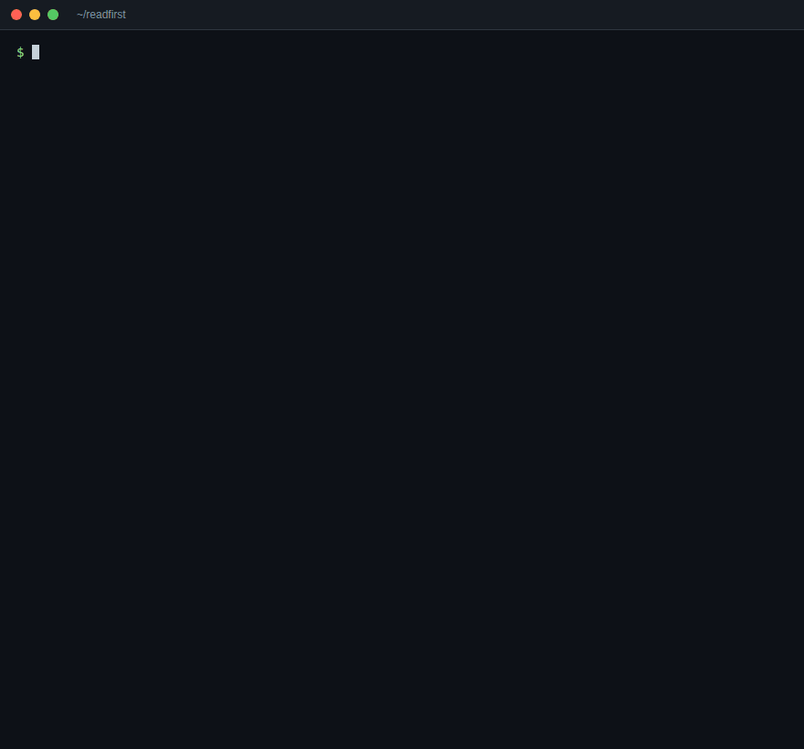

# readfirst

**What to read and check before you — or your AI agent — change a file.**

Coding agents can follow imports. What they don't know is what your team knows: "amounts here are in cents",
"this table is read by the mobile app, keep old columns", "run the payment e2e after touching this". readfirst keeps that
knowledge in one file next to the code and hands it out, file by file, at the moment someone is about to change something.



No server, no account, no model calls. It reads your git checkout and `.readfirst/map.json`.

## Start

Any language; needs Node 20+ for `npx`.

```sh
npx readfirst init --agent   # first map from your folders, checks from your scripts, plus the line for CLAUDE.md / AGENTS.md
npx readfirst prompt         # a brief for your coding agent to fill in titles, checks, risks and rules
npx readfirst check          # every tracked file is in exactly one group (or ignored); rules point at real files
```

Commit `.readfirst/map.json`. From then on:

```sh
npx readfirst read <file>...     # before changing files
npx readfirst diff               # everything your branch changed since main
npx readfirst diff --json        # the same, for tools and agents
npx readfirst verify             # run the checks the map lists for everything your branch changed (exit 1 if one fails)
npx readfirst fix                # after moving code: place new files, drop patterns for deleted ones
```

### Tell your agent to use it

`init --agent` adds this to your `CLAUDE.md`, `AGENTS.md` or `.cursorrules` (or a new `AGENTS.md`); or add it yourself:

```md
Before changing a file, run `npx readfirst read <file>` and follow what it says: keep the rules, read the risks, run the
checks it lists. Before you finish, run `npx readfirst verify`: it runs the checks the map lists for everything you
changed; fix what fails.
When you learn something a newcomer would get wrong, add it as a risk in .readfirst/map.json.
```

### Or let Claude Code pick it up by itself

```sh
npx readfirst hook --install
```

adds a hook to `.claude/settings.json`. Before each Edit or Write, Claude Code gets the rules, risks and checks for that
file as context, once per file per session. Nothing to remember, and the edit is never blocked.

### See the map

```sh
npx readfirst view               # the map as a city in one HTML page: .readfirst/local/view.html
```

Groups are neighbourhoods, files are buildings (taller when more code depends on them), and traffic between
neighbourhoods is the imports between them. A red-lit building has a risk on it; an amber one is under a rule. Point at a
building to see its read list. The page loads three.js from a CDN.

Labels for yourself: `npx readfirst prompt --labels ko` (or `en`, ...) gives your agent a brief to write
`.readfirst/local/labels/ko.json`. It holds a translation of the map in technical terms and plain notes for people new
to the code. The view then has a switch between the two. `.readfirst/local/` is added to `.git/info/exclude`, so labels
stay on your machine and never reach the team's map.

### Any agent, through MCP

`npx readfirst mcp` is an MCP server on stdio with three tools: `read_list` (files → what to read and check before
changing them), `changed_read_list` (the same for everything changed on the branch) and `check_map`. It answers from the
checkout as it is and writes nothing.

```sh
claude mcp add readfirst -- npx --yes readfirst mcp          # Claude Code
```

```json
// Cursor: .cursor/mcp.json · Windsurf: ~/.codeium/windsurf/mcp_config.json
{ "mcpServers": { "readfirst": { "command": "npx", "args": ["--yes", "readfirst", "mcp"] } } }
```

```toml
# Codex: ~/.codex/config.toml
[mcp_servers.readfirst]
command = "npx"
args = ["--yes", "readfirst", "mcp"]
```

The server reads the git repository it is started in. If your agent starts it elsewhere, add `"--root", "/path/to/repo"`
to the arguments.

## On every pull request (GitHub Action)

```yaml
# .github/workflows/readfirst.yml
name: readfirst
on: pull_request
permissions:
  contents: read
  pull-requests: write
jobs:
  readfirst:
    runs-on: ubuntu-latest
    steps:
      - uses: actions/checkout@v4
      - uses: jeonghun917/readfirst@v0
```

Each PR gets one comment, updated on every push, that lists:
- the rules, risks and checks for the files the PR changes, with the checks as boxes to tick;
- the tests that reach the changed code.

A new file next to files the map already places joins their group without anyone touching the map: the check passes
and the comment notes where it went (`npx readfirst fix` writes it down whenever you like). The check fails only on what
needs a person: a new top-level folder, a rule whose files are all gone, a map that is broken in itself. The comment
lists what `npx readfirst fix` would change.

| Input | Default | Meaning |
|---|---|---|
| `fail-on-map-problems` | `true` | `false` reports map problems without failing |
| `strict` | `false` | `true` also fails on new files that are only placed by their neighbours |
| `comment` | `true` | `false` writes only the job summary |
| `limit` | `30` | most tests and users listed per section |

On a PR from a fork, the token is read-only. The list then goes to the job summary instead of a comment.

## The map

```json
{
  "format": "readfirst/map@1",
  "groups": [
    {
      "id": "src-billing",
      "title": "charging cards",
      "files": ["src/billing/**"],
      "checks": [{ "run": "npm test -- billing", "why": "charges" }],
      "risks": [
        { "text": "amounts are in cents" },
        { "text": "index re-exports everything; a rename breaks the API", "files": ["src/billing/index.ts"] }
      ]
    }
  ],
  "rules": [
    {
      "id": "no-double-charge",
      "rule": "a charge runs once per order",
      "why": "refunds are manual",
      "files": ["src/billing/**", "src/api/route.js"],
      "checks": [{ "run": "npm run e2e:pay" }]
    }
  ],
  "ignore": ["img/**"]
}
```

- **files**: a path, `folder/**`, or a `*` glob inside one path segment (`src/*.js`, `**/*.md`).
- **groups**: every tracked file belongs to exactly one group or to `ignore`. `readfirst check` fails otherwise, so the
  map can't quietly fall behind the code (run it in CI).
- **risks**: what a newcomer would get wrong. Leave out `files` when the risk covers the whole group.
- **rules**: promises the code must keep. A rule can span groups.

Tests are found from imports: a test that imports the file directly, or through other files, is listed.
Imports are read for JavaScript/TypeScript, Python, Go, Rust, Elixir, C#, Java, Kotlin, Ruby (including Rails autoloaded
constants) and PHP (through composer's PSR-4 map). `init` suggests the checks those projects already have: `npm test`,
`pytest`, `go test ./...`, `cargo test`, `mix test`, `dotnet test`, `./gradlew test` or `mvn test`, `bundle exec rspec`,
`composer test`.

readfirst needs Node 20 or newer to run, whatever language the project is in. `npx` comes with Node.

## License

MIT
