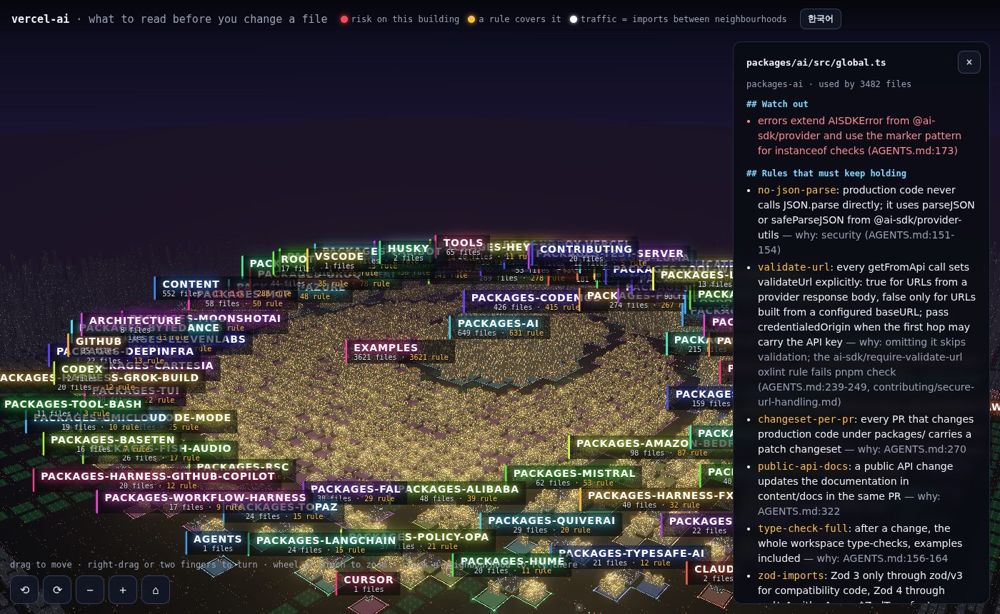

# readfirst guide

Everything the [README](../README.md) leaves out: setup for each agent, the PR Action, the map format and the hosted app.

## Start

Any language; needs Node 20+ for `npx`.

```sh
npx readfirst init --agent --ci   # first map from your folders, checks from your scripts, the line for CLAUDE.md / AGENTS.md,
                                  # and the GitHub Action that comments on PRs and keeps the map in step
npx readfirst prompt         # a brief for your coding agent to fill in titles, checks, risks and rules
npx readfirst check          # every tracked file is in exactly one group (or ignored); rules point at real files
npx readfirst audit          # the whole repository against the map, once: what went stale, what no test reaches
npx readfirst find payment retry   # before writing something new: what in the code may already do it
```

Every release is published from GitHub Actions with npm provenance, and readfirst has no runtime dependencies. To run
exactly the version you reviewed, pin it: `npx readfirst@0.17.1 read <file>` (and `jeonghun917/readfirst@v0.17.1` for
the Action).

In a monorepo, each workspace package with its own `package.json` becomes a group with its own checks
(`pnpm --filter @acme/db test`, `yarn workspace …`, `npm test -w …`), so `verify` runs that package's tests, not the
whole repository's, and its description becomes the group's title.

The first map is the part nobody gets to. [readfirst-app](https://readfirst-cloud.vercel.app/) can write it for you: it
reads the repository and your notes, and opens the map as a pull request with the file and line behind every risk.
Free once per account; see [Hosted](#hosted-readfirst-app).

Commit `.readfirst/map.json`. From then on:

```sh
npx readfirst read <file>...     # before changing files
npx readfirst diff               # everything your branch changed since main
npx readfirst diff --json        # the same, for tools and agents
npx readfirst verify             # run the checks the map lists for everything your branch changed (exit 1 if one fails)
npx readfirst fix                # after moving code: place new files, drop patterns for deleted ones
```

### Tell your agent to use it

`init --agent` and `setup` add this to the agent notes you have (`CLAUDE.md`, `AGENTS.md`, `.cursorrules`, `GEMINI.md`, `.windsurfrules`, `.github/copilot-instructions.md`, or a new `AGENTS.md`); or add it yourself:

```md
Before changing a file, run `npx readfirst read <file>` and follow what it says: keep the rules, read the risks, run the
checks it lists. Before writing a new function or module, run `npx readfirst find <what it does>` and reuse what
already exists. Before you finish, run `npx readfirst verify`: it runs the checks the map lists for everything you
changed; fix what fails.
When you learn something a newcomer would get wrong, add it as a risk in .readfirst/map.json.
```

### Wire every agent at once

```sh
npx readfirst setup                     # the agents this repository shows signs of
npx readfirst setup --for cursor,codex  # or name them
```

It adds the line above to the agent notes, and readfirst's MCP server to each agent's own project config: the Claude
Code hook in `.claude/settings.json`, `.cursor/mcp.json`, `.vscode/mcp.json` (Copilot), `.gemini/settings.json` (and
`GEMINI.md`), `.codex/config.toml` and `opencode.json`. It keeps whatever is already in those files, does nothing the
second time, and never writes outside the repository: a file it cannot parse (JSON with comments) and settings that live
in your home folder (Windsurf) are printed for you to add by hand. Codex reads `.codex/config.toml` only in a project you
have marked as trusted. `init --agent` runs it too.

### As a plugin (Claude Code, Paradev)

The same instructions, packaged: a skill that tells the agent to `read` before editing, `find` before writing new code
and `verify` before finishing, plus (Claude Code) the read-list hook below.

```sh
/plugin install readfirst --marketplace jeonghun917/readfirst          # Claude Code 2.1.275 or later
superset plugins marketplace add jeonghun917/readfirst && superset plugins install readfirst   # Paradev
```

On Paradev the skill reaches every agent in the workspace (Claude Code, Codex, Cursor, Gemini CLI). It runs the CLI
locally like everything else here: no MCP server, no network.

### Or let Claude Code pick it up by itself

```sh
npx readfirst hook --install
```

adds a hook to `.claude/settings.json`. Before each Edit or Write, Claude Code gets the rules, risks and checks for that
file as context, once per file per session. Nothing to remember, and the edit is never blocked.

Want the checks enforced, not just suggested?

```sh
npx readfirst hook --install --verify
```

also adds a Stop hook: before Claude Code finishes its turn, it runs the map's checks for the files it edited in that
session. If one fails, Claude Code cannot finish yet and gets the failure to fix. It gets one try per turn, so a check
it cannot fix never traps the session. It runs only check commands that the map on your main branch already lists: a
command someone's branch adds or changes is named, not run, until it is merged (`npx readfirst verify` runs it when you
choose to).

### See the map

```sh
npx readfirst view               # the map as a city in one HTML page: .readfirst/local/view.html
```



Groups are neighbourhoods, files are buildings (taller when more code depends on them), and traffic between
neighbourhoods is the imports between them. A red-lit building has a risk on it; an amber one is under a rule. Point at a
building to see its read list. The page loads three.js from a CDN.

Labels for yourself: `npx readfirst prompt --labels ko` (or `en`, ...) gives your agent a brief to write
`.readfirst/local/labels/ko.json`. It holds a translation of the map in technical terms and plain notes for people new
to the code. The view then has a switch between the two. `.readfirst/local/` is added to `.git/info/exclude`, so labels
stay on your machine and never reach the team's map.

### Audit the whole repository

`check` asks whether the map covers the files; `npx readfirst audit` asks whether it still tells the truth about them.
It reads the checkout and its git history, runs nothing, changes nothing, and reports:

- **rules and risks that may be out of date**: the line that holds one was written before 10 or more commits changed
  the files it covers (git blame on the map, git log on the files). Each says when it was written and how much moved since;
- **hot spots no longer at their line**, and where the function is now, and **hot spots nothing checks**: no test
  reaches their file and no check of their own covers them (a check most groups share, like the whole suite, does not count);
- **what was never filled in**: groups still titled `TODO:` from `init`, rules no check verifies;
- **code no test reaches through imports**, the most used first, with a count per group;
- **code nothing else uses**: in a module other files import, an export (JavaScript, TypeScript) or a top-level `def` or
  `class` (Python) that no other file names and its own file does not use. Names a framework calls by convention
  (`GET`, `loader`, `config`) and decorated Python functions are left out. A name built at run time is not seen, so each
  one is a place to look before deleting, not a verdict;
- **code being replaced that is still used** (groups marked `deprecated`), and, with `.readfirst/held.json`, **rules
  never recorded as holding** or whose files changed after they last held;
- **what readfirst could not see**: languages whose imports it does not read, and modules loaded by a computed name
  (``import(`./plugins/${name}`)``, `importlib.import_module(settings.X)`). An empty "used by" for those means unknown,
  not none; read lists now say so too.

`--json` gives the same as `readfirst/audit@1`. On a 4,700-file Django repository it takes about two seconds.

### Before writing something new

The commonest waste in agent-written code is a second copy of a helper that already exists. `npx readfirst find
payment retry` lists the functions, classes and types whose names hold those words (`retryPayment`,
`retry_failed_payment`), the files whose paths do, and the groups, rules and risks of the map that mention them: the
closest names first, code before tests, each with how many files use it and its group.

It matches words, not meaning: `retries` meets `retry` and `pay` meets `payment`, the folder a function sits in counts
too (`webhook/transport` for `signature_for_payload` on "webhook signature"), and so does the comment right above a
definition or a Python docstring (shown as "in its comment"), but `try_again` with no comment is not found for "retry".
Words like "add", "new" or "helper" are ignored. No model, no index, nothing written; on a 4,700-file repository it takes
under two seconds. `--json` gives `readfirst/find@1`.

### Any agent, through MCP

`npx readfirst mcp` is an MCP server on stdio with five tools: `read_list` (files → what to read and check before
changing them), `changed_read_list` (the same for everything changed on the branch), `find_existing` (the search
above, before writing something new), `check_map` and `audit_repo` (the audit above). It answers from the checkout as it is and writes nothing.

```sh
claude mcp add readfirst -- npx --yes readfirst mcp          # Claude Code
```

```json
// Cursor: .cursor/mcp.json · Windsurf: ~/.codeium/windsurf/mcp_config.json
{ "mcpServers": { "readfirst": { "command": "npx", "args": ["--yes", "readfirst", "mcp"] } } }
```

```toml
# Codex: ~/.codex/config.toml
[mcp_servers.readfirst]
command = "npx"
args = ["--yes", "readfirst", "mcp"]
```

The server reads the git repository it is started in. If your agent starts it elsewhere, add `"--root", "/path/to/repo"`
to the arguments.

### Cursor rules, from the same map

`npx readfirst export --cursor` writes one `.cursor/rules/readfirst-<group>.mdc` per group, scoped to the group's
files by glob, with its rules, risks and checks. Cursor then attaches them whenever those files are in play. Commit them
and add `npx readfirst export --cursor --check` to CI: it fails when the map changed and the rules did not. Only files
named `readfirst-*.mdc` are written or removed; your own rules in `.cursor/rules` are left alone, and the exported files
need no group in the map.

### Why not just CLAUDE.md or Cursor rules?

Folder `CLAUDE.md` files and Cursor's glob rules attach text to paths, and that is often enough. readfirst adds what
they leave to you:

- **It can't go stale quietly.** `check` fails in CI when a file is in no group or a pattern matches nothing, and
  `audit` lists rules written before their files changed a lot. Prose in a folder has no such check.
- **It knows the code around the file.** Read lists add the tests that reach a file through imports and the files that
  use it; `verify` runs only the checks for what changed; `find` shows what already exists before you write it again.
- **One source for every tool.** The same map feeds the Claude Code hook, any MCP agent, the PR comment and, with
  `export --cursor`, Cursor's own rules.

Keeping the map up is mostly automatic: `fix` places new files beside their neighbours, `check` lets a new file in a
known folder pass, the Action's auto-fix commits the map change to the PR, and hosted upkeep (Pro) proposes edits after
a merge.

## On every pull request (GitHub Action)

```yaml
# .github/workflows/readfirst.yml
name: readfirst
on: pull_request
permissions:
  contents: read
  pull-requests: write
jobs:
  readfirst:
    runs-on: ubuntu-latest
    steps:
      - uses: actions/checkout@v4
      - uses: jeonghun917/readfirst@v0
```

Each PR gets one comment, updated on every push, that lists:
- the rules, risks and checks for the files the PR changes, with the checks as boxes to tick;
- the tests that reach the changed code.

A new file next to files the map already places joins their group without anyone touching the map: the check passes
and the comment notes where it went (`npx readfirst fix` writes it down whenever you like). The check fails only on what
needs a person: a new top-level folder, a rule whose files are all gone, a map that is broken in itself. The comment
lists what `npx readfirst fix` would change.

| Input | Default | Meaning |
|---|---|---|
| `fail-on-map-problems` | `true` | `false` reports map problems without failing |
| `strict` | `false` | `true` also fails on new files that are only placed by their neighbours |
| `comment` | `true` | `false` writes only the job summary |
| `auto-fix` | `false` | `true` commits what `readfirst fix` settles (new files placed by their neighbours) to the PR branch |
| `limit` | `30` | most tests and users listed per section |

On a PR from a fork, the token is read-only. The list then goes to the job summary instead of a comment.

### Keep the map in step without thinking about it

```yaml
permissions:
  contents: write        # for auto-fix
  pull-requests: write
# ...
      - uses: jeonghun917/readfirst@v0
        with:
          auto-fix: true
```

With `auto-fix`, when a PR adds files next to ones the map already places, the Action writes them into the map and
commits that to the PR branch. That is the mechanical part `npx readfirst fix` does, nothing else: new risks and
rules stay for a person. It skips PRs from forks, and it skips the commit if the branch's map changed since the run
started, so a push is never overwritten. A commit made with the default `GITHUB_TOKEN` does not start new workflow
runs. If your branch protection requires checks, pass a GitHub App or personal token as `token`.

## The map

```json
{
  "format": "readfirst/map@1",
  "groups": [
    {
      "id": "src-billing",
      "title": "charging cards",
      "files": ["src/billing/**"],
      "checks": [{ "run": "npm test -- billing", "why": "charges" }],
      "risks": [
        { "text": "amounts are in cents" },
        { "text": "index re-exports everything; a rename breaks the API", "files": ["src/billing/index.ts"] }
      ]
    }
  ],
  "rules": [
    {
      "id": "no-double-charge",
      "rule": "a charge runs once per order",
      "why": "refunds are manual",
      "files": ["src/billing/**", "src/api/route.js"],
      "checks": [{ "run": "npm run e2e:pay" }]
    }
  ],
  "requires": [
    { "when": ["src/billing/models.ts"], "also": ["migrations/**"], "why": "a model change needs a migration" }
  ],
  "dependents": [
    { "files": ["src/api/route.js"], "repo": "acme/web", "paths": ["src/client.ts"], "why": "the web app calls this route" }
  ],
  "ignore": ["img/**"]
}
```

- **files**: a path, `folder/**`, or a `*` glob inside one path segment (`src/*.js`, `**/*.md`).
- **groups**: every tracked file belongs to exactly one group or to `ignore`. `readfirst check` fails otherwise, so the
  map can't quietly fall behind the code (run it in CI).
- **risks**: what a newcomer would get wrong. Leave out `files` when the risk covers the whole group.
- **rules**: promises the code must keep. A rule can span groups.
- **hotspots** (optional, usually written by a tool): functions where risky code meets a rule, as
  `{ "file", "symbol", "line", "labels": ["db-write", "money"], "rules"?: [...], "note"? }`. `read` lists the ones in the
  file being changed under "Hot spots in this code"; `fix` drops those whose file is gone.
- **flows** (optional, written by a tool): where outside input enters and what it reaches, as
  `{ "entry": "POST /orders/:id", "file", "line", "checks": ["requireRole"], "reaches": [{ "file", "symbol", "line",
  "labels": ["db-write"], "tables"?: ["orders"] }] }`. `checks` names what decides who may do it on the way, and is empty
  when none was found; `tables`, when known, names the database tables the reached code writes or reads.
  `read` lists the flows that start in or reach the file being changed under "Outside input reaches this code"; `fix`
  drops those whose files are gone. Older readfirst versions reject maps that have it.
- **vocabulary** (optional): the repository's own words, for tools that read the code with no model, as
  `{ "checks": [{ "name", "evidence", "why"? }], "sinks": [{ "call", "label", "evidence", "why"? }], "notChecks": [{ "name",
  "why", "evidence"? }], "public": [{ "entry", "why" }] }`. `checks` are functions that decide who may do something,
  `sinks` calls that do something that matters (label such as `db-write`), `notChecks` names that look like checks but
  refuse no one, `public` entries open to anyone on purpose. A name may hold `*`; `evidence` is `file:line`. `read` lists
  the ones whose evidence is in the file being changed; `fix` drops those whose file is gone. Older readfirst versions
  reject maps that have it.
- **deprecated** (optional, on a group): code being replaced, as `{ "why": "...", "use"?: "billing" }` where `use` is the
  group or path to use instead. Read lists open with "Being replaced", the hook tells the agent not to add to it,
  `find` lists its matches last with what to use instead, and `audit` counts the files outside it that still import it.

- **requires** (optional): files that change together, as `{ "when", "also", "why" }`. When a change touches a file
  matching `when` and nothing matching `also`, `verify` fails, the Claude Code Stop hook sends the agent back once, and
  the read list says "Change these too". `also` may name files that don't exist yet (the next migration).
- **dependents** (optional): other repositories that depend on files here, as `{ "files", "repo", "paths"?, "why" }`.
  `read` lists them under "Other repositories depend on this" and `verify` reminds you of them. readfirst can't see the
  other repository from your checkout, so it never says "no impact" there; the hosted version checks it.

### What "done" means

`verify` is the gate: the change is done when every check the map lists for the changed files passes and no file the
map ties to them (`requires`) was left out. It also names the rules on those files that no check covers ("nothing here
shows they still hold") and the other repositories that depend on them. Those two don't fail it; they say what is
still unproven. With `hook --install --verify`, Claude Code runs the same gate before it finishes and gets one try to
fix what fails. Passing it means the checks you wrote passed, nothing more.

### When rules last held

`npx readfirst verify --record` runs the checks as usual, then writes `.readfirst/held.json`: for every rule whose
checks all passed in that run, the commit and the date. Commit it with the change. Read lists then show
"held at 3f2a91c on 2026-11-03" (or "never recorded as holding") next to each rule that has checks, and `audit` lists
rules never recorded and rules whose files changed in commits after they last held. A rule with no check is never
recorded: give it one. The file belongs to no group, like the map.

Tests are found from imports: a test that imports the file directly, or through other files, is listed.
Imports are read for JavaScript/TypeScript, Python (from the root, `src/`, or the folder that holds Django's `manage.py`;
Python 2's implicit relative imports too), Go, Rust, Elixir, C#, Java, Kotlin, Ruby (including Rails autoloaded
constants) and PHP (through composer's PSR-4 map). `init` suggests the checks those projects already have: `npm test`,
`pytest`, `go test ./...`, `cargo test`, `mix test`, `dotnet test`, `./gradlew test` or `mvn test`, `bundle exec rspec`,
`composer test`.

readfirst needs Node 20 or newer to run, whatever language the project is in. `npx` comes with Node.

## Hosted (readfirst-app)

Everything above is free and stays free. The GitHub App adds the parts that take a person's time:

- **First map:** install [readfirst-app](https://github.com/apps/readfirst-app/installations/new) on a repository and
  comment `/readfirst fill` on any issue. 5–20 minutes later a pull request arrives with the map, each risk and rule
  citing the file and line it came from. Free once per account, for repositories up to 200 files.
- **Pro, $19/month:** fills for up to 3 private repositories that also read where the code broke before and the known
  traps of its libraries; after each merge, a small PR when the map needs it; on every pull request, a comment on the
  lines that look like they break a rule in your map and the files it touches that broke before.
  [Get Pro](https://readfirst-cloud.vercel.app/#pricing).
- **Map setup, $290 once:** we write the first maps for up to 3 repositories from your code, its history, your docs and
  a short email Q&A, and send them as pull requests with the Action and your agent's setup. No calls; 5 business days;
  first month of Pro included. [Book a setup](https://readfirst-cloud.vercel.app/#pricing).

The CLI, hook, MCP server and Action never send your code anywhere. What the app reads and keeps is listed on
[the site](https://readfirst-cloud.vercel.app/#your-code).
