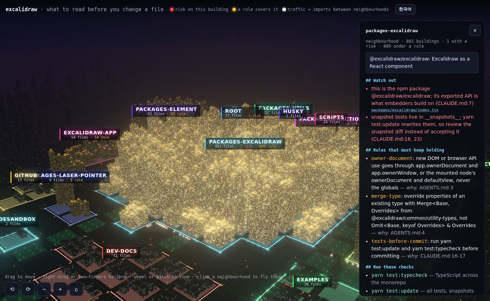

# excalidraw

[excalidraw/excalidraw](https://github.com/excalidraw/excalidraw) at `8bcdca4`. 1,328 files in 18 groups, 3 rules.



Where it came from:
- `CLAUDE.md` and `AGENTS.md`: package vs app work, snapshot tests, `ownerDocument`, `Merge`
- `package.json` dependencies: which package may import which

## Before editing an element module

```markdown
# Read first: `packages/element/src/groups.ts`

## Rules that must keep holding

- **owner-document**: new DOM or browser API use goes through app.ownerDocument and app.ownerWindow, or the mounted node's ownerDocument and defaultView, never the globals — why: AGENTS.md:3
- **merge-type**: override properties of an existing type with Merge<Base, Overrides> from @excalidraw/common/utility-types, not Omit<Base, keyof Overrides> & Overrides — why: AGENTS.md:4
- **tests-before-commit**: run yarn test:update and yarn test:typecheck before committing — why: CLAUDE.md:16-17

## Watch out

- @excalidraw/excalidraw depends on this package, so code here imports only types from @excalidraw/excalidraw/types; a runtime import would be a cycle (package.json dependencies; packages/element/src/utils.ts:36) _(group packages-element)_

## Run these checks

- `yarn test:typecheck` — TypeScript across the monorepo
- `yarn test:update` — all tests, snapshots updated (CLAUDE.md:16)
```

## Before editing the published component

```markdown
# Read first: `packages/excalidraw/index.tsx`

## Rules that must keep holding

- **owner-document**: new DOM or browser API use goes through app.ownerDocument and app.ownerWindow, or the mounted node's ownerDocument and defaultView, never the globals — why: AGENTS.md:3
- **merge-type**: override properties of an existing type with Merge<Base, Overrides> from @excalidraw/common/utility-types, not Omit<Base, keyof Overrides> & Overrides — why: AGENTS.md:4
- **tests-before-commit**: run yarn test:update and yarn test:typecheck before committing — why: CLAUDE.md:16-17

## Watch out

- this is the npm package @excalidraw/excalidraw; its exported API is what embedders build on (CLAUDE.md:7) _(group packages-excalidraw)_
- snapshot tests live in __snapshots__; yarn test:update rewrites them, so review the snapshot diff instead of accepting it (CLAUDE.md:16, 23) _(group packages-excalidraw)_

## Run these checks

- `yarn test:typecheck` — TypeScript across the monorepo
- `yarn test:update` — all tests, snapshots updated (CLAUDE.md:16)
```
