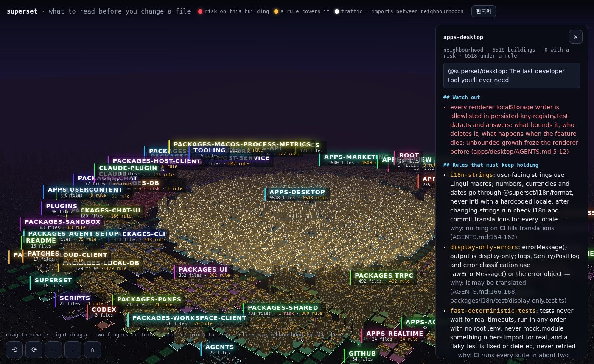

# superset

[superset-sh/superset](https://github.com/superset-sh/superset) at `1982e32d`. 14,654 files in 56 groups, 5 rules.



Where it came from:
- `AGENTS.md` (275 lines): migrations, generated plugin manifests, i18n and its traps, display-only error messages, test rules, the one installed_plugins.json
- `packages/trpc/AGENTS.md`, `packages/host-service/AGENTS.md`: additive-only changes for procedures released clients call
- `apps/desktop/AGENTS.md`: the localStorage policy
- checks: each workspace package's own scripts through `bun --filter`, plus `check:plugins` and `check:i18n`

## Before editing a tRPC router

```markdown
# Read first: `packages/trpc/src/router/page/page.ts`

## Rules that must keep holding

- **display-only-errors**: errorMessage() output is display-only; logs, Sentry/PostHog and error classification use rawErrorMessage() or the error object — why: it may be translated (AGENTS.md:166-168, packages/i18n/test/display-only.test.ts)
- **trpc-additive**: procedures that released clients call change only additively — why: desktop 1.24.0 got a 405 on every query to hosts on 1.23.x after a transport change (packages/trpc/AGENTS.md:34-36)

## Watch out

- never a breaking change to a procedure released clients call: add a new procedure instead; new inputs optional; no tightened inputs, changed outputs, error codes or query/mutation type (packages/trpc/AGENTS.md:12-36) _(group packages-trpc)_

## Run these checks

- `bun --filter @superset/trpc run test` — the test suite of @superset/trpc
- `bun --filter @superset/trpc run typecheck` — types of @superset/trpc
```

## Before editing the database schema

```markdown
# Read first: `packages/db/src/schema/index.ts`

## Rules that must keep holding

- **display-only-errors**: errorMessage() output is display-only; logs, Sentry/PostHog and error classification use rawErrorMessage() or the error object — why: it may be translated (AGENTS.md:166-168, packages/i18n/test/display-only.test.ts)

## Watch out

- a db.query findMany/findFirst without columns passes table columns into tRPC output, so a column change here is an API output change (packages/trpc/AGENTS.md:28-31) _(group packages-db)_

## Run these checks

- `bun --filter @superset/db run typecheck` — types of @superset/db
```
