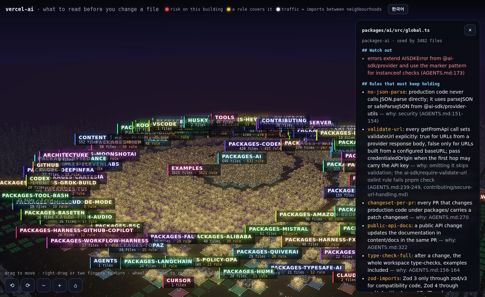

# vercel-ai

[vercel/ai](https://github.com/vercel/ai) at `ad09bc1`. 9,630 files in 101 groups, 6 rules.



Where it came from:
- `AGENTS.md`: JSON parsing, `validateUrl` on every `getFromApi`, response and option schemas, changesets, Zod imports, the Do Not list
- `contributing/secure-url-handling.md` for the URL rule
- checks: each package's own scripts through `pnpm --filter`, plus `pnpm check` and `pnpm type-check:full` from the root

## Before editing a provider

```markdown
# Read first: `packages/openai/src/image/openai-image-model.ts`

## Rules that must keep holding

- **no-json-parse**: production code never calls JSON.parse directly; it uses parseJSON or safeParseJSON from @ai-sdk/provider-utils — why: security (AGENTS.md:151-154)
- **validate-url**: every getFromApi call sets validateUrl explicitly: true for URLs from a provider response body, false only for URLs built from a configured baseURL; pass credentialedOrigin when the first hop may carry the API key — why: omitting it skips validation; the ai-sdk/require-validate-url oxlint rule fails pnpm check (AGENTS.md:239-249, contributing/secure-url-handling.md)
- **changeset-per-pr**: every PR that changes production code under packages/ carries a patch changeset — why: AGENTS.md:270
- **type-check-full**: after a change, the whole workspace type-checks, examples included — why: AGENTS.md:156-164
- **zod-imports**: Zod 3 only through zod/v3 for compatibility code, Zod 4 through zod/v4 with z4.core.$ZodType for type references — why: the SDK supports both (AGENTS.md:138-149)

## Watch out

- response schemas use .nullish() and only the properties you need; provider options schemas use .optional() and stay as restrictive as possible (AGENTS.md:229-237) _(group packages-openai)_

## Run these checks

- `pnpm --filter @ai-sdk/openai test` — the test suite of @ai-sdk/openai
- `pnpm --filter @ai-sdk/openai run type-check` — types of @ai-sdk/openai
- `pnpm check` — keeps rule no-json-parse
- `pnpm type-check:full` — keeps rule type-check-full
```

## Before editing generateText

```markdown
# Read first: `packages/ai/src/generate-text/generate-text.ts`

## Rules that must keep holding

- **no-json-parse**: production code never calls JSON.parse directly; it uses parseJSON or safeParseJSON from @ai-sdk/provider-utils — why: security (AGENTS.md:151-154)
- **validate-url**: every getFromApi call sets validateUrl explicitly: true for URLs from a provider response body, false only for URLs built from a configured baseURL; pass credentialedOrigin when the first hop may carry the API key — why: omitting it skips validation; the ai-sdk/require-validate-url oxlint rule fails pnpm check (AGENTS.md:239-249, contributing/secure-url-handling.md)
- **changeset-per-pr**: every PR that changes production code under packages/ carries a patch changeset — why: AGENTS.md:270
- **public-api-docs**: a public API change updates the documentation in content/docs in the same PR — why: AGENTS.md:322
- **type-check-full**: after a change, the whole workspace type-checks, examples included — why: AGENTS.md:156-164
- **zod-imports**: Zod 3 only through zod/v3 for compatibility code, Zod 4 through zod/v4 with z4.core.$ZodType for type references — why: the SDK supports both (AGENTS.md:138-149)

## Watch out

- errors extend AISDKError from @ai-sdk/provider and use the marker pattern for instanceof checks (AGENTS.md:173) _(group packages-ai)_

## Run these checks

- `pnpm --filter ai test` — the test suite of ai
- `pnpm --filter ai run type-check` — types of ai
- `pnpm check` — keeps rule no-json-parse
- `pnpm type-check:full` — keeps rule type-check-full
```
